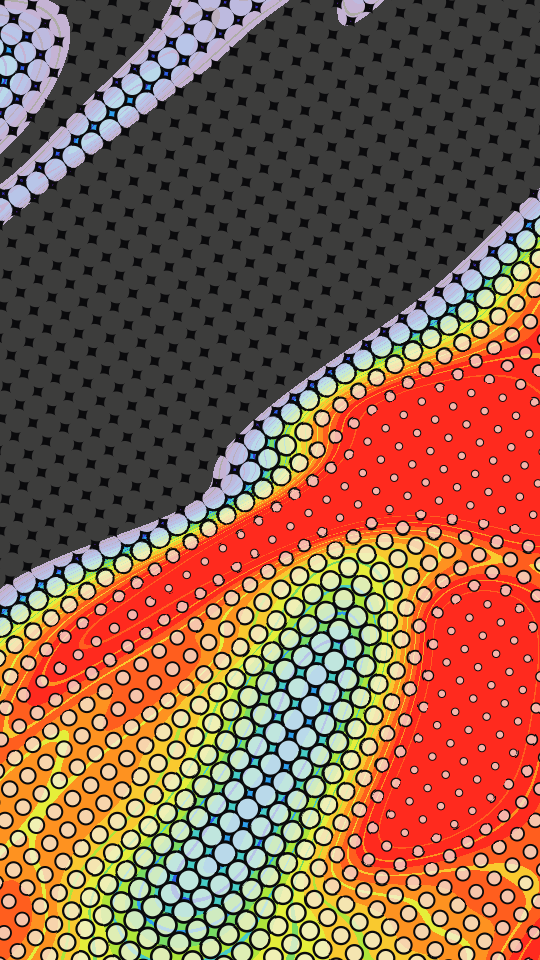

A turbulent heat field cut into flat bands along a ramp of inks, seen through a turned screen of ringed dots. Dots grow where the field is cold. Each dot is a dark ring around a pale core, so the sheet reads like a cheap thermal print.

benday renders a Loop: 36 frames at 12 fps, in which the heat field drifts once round a small circle and its fine detail drifts twice as far. The dot screen holds still, so the bands creep under it and the dots grow and shrink in place. The field is already shifted at frame 0, so frame 0 differs from the Still. Its site page is [playgrnd.tools/benday](https://www.playgrnd.tools/benday/).

## Still



Seed 6, rendered by:

```sh
tirage derive --seed 6 --tool benday | tirage render --size 540x960 -o benday.png
```

## Parameters

From [`tirage tools`](/cli-reference/tools/), without the 11 shared [dither and grain](/concepts/dither-and-grain/) Parameters:

```
benday  36 frames
  turb        0..=1     step 0.01
  streak      0..=1     step 0.01
  dir         -1..=1    step 0.01
  scale       0..=1     step 0.01
  black       0..=1     step 0.01
  bands       2..=16    step 1
  rims        0..=1     step 0.01
  dot         0..=1     step 0.01
  ring        0..=1     step 0.01
  angle       0..=1     step 0.01
  bite        0..=1     step 0.01
```

A Seed draws all 11 art Parameters. Each range comes from its [Taste bounds](/concepts/taste-bounds/), which sit within the range listed.

The Palette is a ramp read cold to hot and takes any number of inks from 2. The first ink is also the dot ring.
