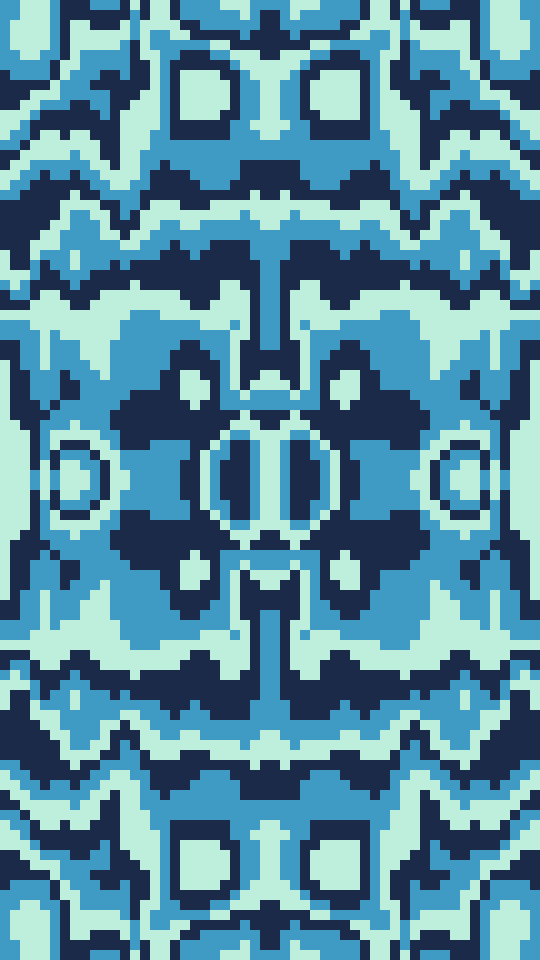

Pixel rings. A grid of square cells is coloured by its distance from the middle of the frame, cut into bands that step through the Palette. Noise pushes the rings out of round and roughens their edges, and a quiet disc in the middle keeps the first ink. The grid is mirrored left to right and top to bottom.

bloom renders a Loop: 24 frames at 8 fps, in which the rings step outward through the Palette once while the quiet centre holds. Frame 0 is the Still. Its site page is [playgrnd.tools/bloom](https://www.playgrnd.tools/bloom/).

## Still



Seed 1, rendered by:

```sh
tirage derive --seed 1 --tool bloom | tirage render --size 540x960 -o bloom.png
```

SVG: yes. `-o bloom.svg` writes this Still as an [SVG](/cli-reference/render/#svg).

## Loop

<video src="/tools/bloom.mp4" width="360" height="640" autoplay loop muted playsinline></video>

The same Seed 1, encoded at 360x640 by:

```sh
tirage derive --seed 1 --tool bloom | tirage encode --size 360x640 -o bloom.mp4
```

## Parameters

From [`tirage tools`](/cli-reference/tools/), without the 11 shared [dither and grain](/concepts/dither-and-grain/) Parameters:

```
bloom  24 frames, svg
  cols        8..=96    step 1
  rings       1..=14    step 1
  warp        0..=1     step 0.01
  grain       0..=1     step 0.01 [no Taste]
  steps       2..=14    step 1
  calm        0..=1     step 0.01
```

A Seed draws `cols`, `rings`, `warp`, `steps` and `calm`. Each range comes from its [Taste bounds](/concepts/taste-bounds/), which sit within the range listed: `rings` stays within 4..=14, `steps` within 2..=8 and `calm` within 0..=0.5. `grain`, bloom's own roughness on the band edges, stays at 0.3. The Palette is a ramp from the deepest band to the palest, and every ink is used whatever `steps` is.
