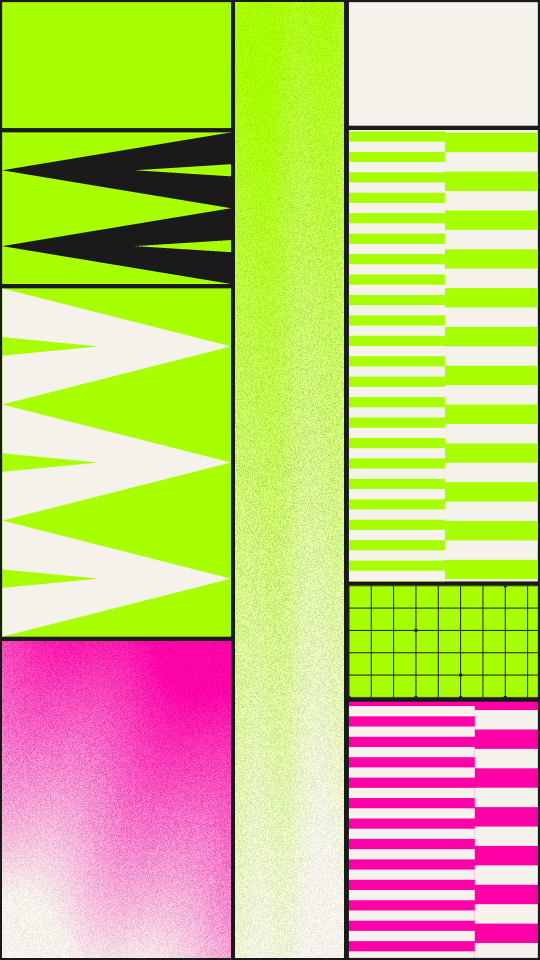

A report cover cut into rectangles. Each cut splits one of the larger panels, so the frame fills in evenly. A panel is a flat ink or a pattern in two inks: stripes that change pitch partway across, stacked chevrons, a grainy ramp, or a grid of lines with a few dots on its crossings. A picture has at most one grid.

carve renders a Loop: 36 frames at 12 fps, in which stripes travel one stripe period along their panel and grainy ramps wash towards one ink while their streaks turn, as the layout, flat, chevron and grid panels hold. Frame 0 is the Still. A ramp does not land back on frame 0, so a picture with one jumps at the end, as it does on the site. Its site page is [playgrnd.tools/carve](https://www.playgrnd.tools/carve/).

## Still



Seed 2, rendered by:

```sh
tirage derive --seed 2 --tool carve | tirage render --size 540x960 -o carve.png
```

SVG: yes. `-o carve.svg` writes this Still as an [SVG](/cli-reference/render/#svg). It is partly raster: ramp panels are drawn pixel by pixel, so the SVG holds them as embedded PNG images.

## Parameters

As [`tirage tools`](/cli-reference/tools/) lists them, each with its range and step, or its choices:

```
carve  36 frames, svg
  cuts        1..=16    step 1
  uneven      0..=1     step 0.01
  gap         0..=1     step 0.01
  mix         0..=1     step 0.01
  pitch       0..=1     step 0.01
  grain       0..=1     step 0.01
  nodes       0..=1     step 0.01
  ditherTog   on/off
  dthKinds    Bayer 8, Bayer 4, Noise
  dthSize     1..=10    step 1
  dthLevels   2..=8     step 1
  dthAmount   0..=1     step 0.05
  grainTog    on/off
  grnBlends   Add, Overlay, Soft light, Multiply, Screen
  grnAmount   0..=1     step 0.05
  grnSize     0.5..=4   step 0.1
  grnSpecks   0..=1     step 0.05
  grnVignette 0..=1     step 0.05
```

A Seed draws every Parameter above `ditherTog` except `grain`, each across its full range. `cuts` is how many times the frame is split and `uneven` how far each split strays from the middle. `gap` opens a gutter between panels. `mix` is the chance that a panel gets a pattern, `pitch` sets the stripe width and `nodes` the grid density. `grain`, the noise in the ramp panels, stays at 0.5. Dither and the grain post-pass stay off.

The Palette takes any number of inks from 2. The first ink is also the ground. Each panel picks its two inks by position from the whole Palette.
