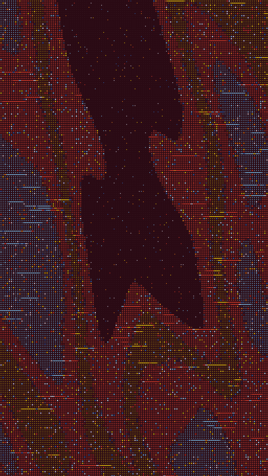

A coded sheet. A grid of small glyphs sits on a dark ground: squares, diamonds, ringed squares and x's. A field is cut into bands, and every cell takes the glyph and ink of its band, so the bands draw a figure, a contour relief or a slope. Stray squares in other inks, x's along the band edges and smeared rows break up the grid.

cipher renders a Loop: 36 frames at 12 fps, in which the field under the grid drifts once round a small circle, so the band edges ripple and cells swap glyph and ink as they cross into another band. The grid, the flecks and the smeared rows hold still. The field has already moved at frame 0, so frame 0 differs from the Still. Its site page is [playgrnd.tools/cipher](https://www.playgrnd.tools/cipher/).

## Still



Seed 1, rendered by:

```sh
tirage derive --seed 1 --tool cipher | tirage render --size 540x960 -o cipher.png
```

## Loop

<video src="/tools/cipher.mp4" width="360" height="640" autoplay loop muted playsinline></video>

The same Seed 1, encoded at 360x640 by:

```sh
tirage derive --seed 1 --tool cipher | tirage encode --size 360x640 -o cipher.mp4
```

## Parameters

From [`tirage tools`](/cli-reference/tools/), without the 11 shared [dither and grain](/concepts/dither-and-grain/) Parameters:

```
cipher  36 frames
  cells       20..=140  step 1
  bands       2..=7     step 1
  fields      Figure, Relief, Slope
  wave        0..=1     step 0.01
  tilt        -1..=1    step 0.01
  detail      0..=1     step 0.01
  size        0.3..=1   step 0.01
  edges       0..=1     step 0.01
  flecks      0..=0.3   step 0.01
  smears      0..=0.6   step 0.01
  dots        0..=1     step 0.01
```

A Seed draws every Parameter listed. Each range comes from its [Taste bounds](/concepts/taste-bounds/), which sit within the range listed: `size` stays within 0.48..=1, because smaller glyphs fade into the ground. `fields` picks what the bands trace. `cells` is how many glyphs span the frame. The last band is always the ground, with a faint dot in each cell that `dots` sizes.

The Palette takes any number of inks from 2. The first ink is the ground, and every later ink can colour a band, a stray square or an edge mark.
