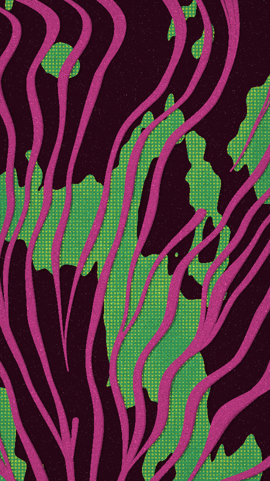

A sea fan printed on textile. Ribbed branches grow from a root off the edge of the frame and fork as they spread, so they stay evenly spaced. Torn paper lobes lie over and under them, with a dot screen printed on the paper.

coral renders a Loop: 36 frames at 12 fps, in which the wobble that bends the branches walks once round a small circle, so they lean and come back. The root, the paper and the dot screen hold still. The branches already lean at frame 0, so frame 0 differs from the Still. With `wobble` at 0 nothing bends, and every frame is the Still. Its site page is [playgrnd.tools/coral](https://www.playgrnd.tools/coral/).

## Still



Seed 8, rendered by:

```sh
tirage derive --seed 8 --tool coral | tirage render --size 540x960 -o coral.png
```

## Parameters

From [`tirage tools`](/cli-reference/tools/), without the 11 shared [dither and grain](/concepts/dither-and-grain/) Parameters:

```
coral  36 frames
  branches    2..=12    step 1
  spacing     0..=1     step 0.01
  spread      0..=1     step 0.01
  width       0.1..=1   step 0.01
  wobble      0..=1     step 0.01
  cover       0..=1     step 0.01
  size        0..=1     step 0.01
  beneath     0..=1     step 0.01
  ribs        0..=1     step 0.01
  dots        0..=1     step 0.01
  shadow      0..=1     step 0.01
```

A Seed draws every Parameter listed across its full range, the [Taste bounds](/concepts/taste-bounds/) shipped for coral. The grain post-pass is on, as the site page opens: Multiply, amount 0.45, specks 0.4, vignette 0.3. coral reads its Palette by role: ground, branch, rib, lobe and dot. A shorter Palette derives the missing roles from the inks it has.
