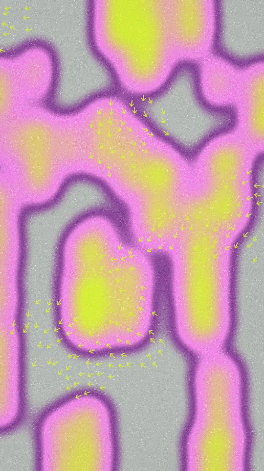

A crowd seen through a heat camera. Each figure, a head on a pair of shoulders, is a soft blob in false colour: ground where nobody stands, a halo with a dark rim round every figure, and a solid core. Small arrows gather in patches over the top, each patch leaning its own way.

crowd renders a Loop: 36 frames at 12 fps, in which every figure walks once round a small circle about its place, each on its own beat, and its edge ripples as it passes through the noise. The arrows, the noise and the inks hold still. The figures are already off their places at frame 0, so frame 0 differs from the Still. Its site page is [playgrnd.tools/crowd](https://www.playgrnd.tools/crowd/).

## Still



Seed 1, rendered by:

```sh
tirage derive --seed 1 --tool crowd | tirage render --size 540x960 -o crowd.png
```

## Parameters

From [`tirage tools`](/cli-reference/tools/), without the 11 shared [dither and grain](/concepts/dither-and-grain/) Parameters:

```
crowd  36 frames
  crowd       1..=48    step 1
  scale       0..=1     step 0.01
  wobble      0..=1     step 0.01
  blur        0..=1     step 0.01
  halo        0..=1     step 0.01
  edge        0..=1     step 0.01
  arrows      0..=1     step 0.01
  arrowSize   0..=1     step 0.01
```

A Seed draws `crowd` from 8 to 48 and `scale` from 0 to 0.6. One figure leaves the frame almost bare, and big figures flood it with core ink. Every other slider spans its full range. `crowd` is how many figures stand in the frame, `halo` how wide the band round each one is, and `edge` how dark its rim is. `arrows` sets how much of the frame the arrows cover, and `arrowSize` their size and spacing. Grain stays on as the site opens it: overlay at 0.35.

The Palette takes any number of inks from 2, read by role. The first ink is the ground, the second the core of every figure and the arrows. Any further inks are halo bands, outermost first. With 2 inks the halo is the core ink.
