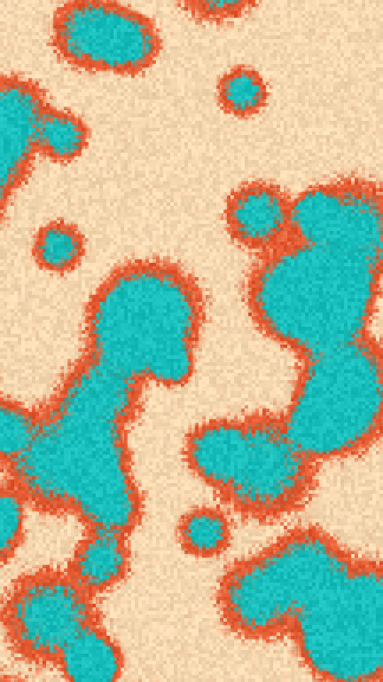

Colonies on a culture plate. Each cell drops a soft bump into one field and the bumps add up, so cells that meet fuse into one colony. The field is cut into rings, the plate outside them and each later ink a ring further in, with a grain that bites into the ring edges.

culture renders a Loop: 36 frames at 12 fps, in which every cell circles once around its place, each on its own beat, and the colonies merge and part as their cells pass. The rings, grain and inks hold still. The cells are already off their places at frame 0, so frame 0 differs from the Still. Its site page is [playgrnd.tools/culture](https://www.playgrnd.tools/culture/).

## Still



Seed 14, rendered by:

```sh
tirage derive --seed 14 --tool culture | tirage render --size 540x960 -o culture.png
```

## Parameters

From [`tirage tools`](/cli-reference/tools/), without the 11 shared [dither and grain](/concepts/dither-and-grain/) Parameters:

```
culture  36 frames
  count       1..=90    step 1
  size        0..=1     step 0.01
  fuse        0..=1     step 0.01
  cover       0..=1     step 0.01
  spread      0.05..=2  step 0.01
  soft        0.02..=1  step 0.01
  textures    Fine, Stipple
  grain       0..=1     step 0.01
  dot         1..=10    step 1
```

A Seed draws every Parameter listed except `grain`. Each range comes from its [Taste bounds](/concepts/taste-bounds/), which sit within the range listed: `count` stays within 15..=70, `size` within 0.15..=0.6 and `fuse` within 0..=0.8. `grain`, the Tool's own grain, stays at 0.62. The first ink is the plate, and every later ink is a ring further in.
