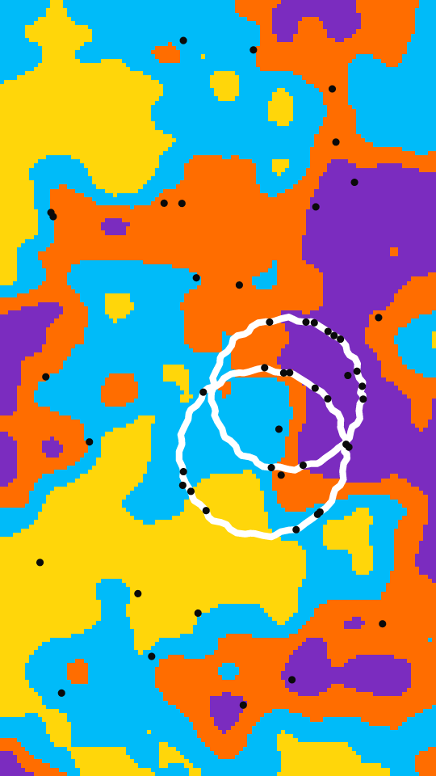

A festival poster. Noise patches in bright inks fill a coarse grid that is blown up with hard pixel edges. One big white doodle sits on top, with black dots scattered over the frame and along the line.

fete renders a Loop: 100 frames at 20 fps, in which the doodle and the dots on it draw themselves on over the first 82 frames and then hold, while the patches and the other dots stay put. Frame 0 has no doodle yet, so it differs from the Still. Its site page is [playgrnd.tools/fete](https://www.playgrnd.tools/fete/).

## Still



Seed 1, rendered by:

```sh
tirage derive --seed 1 --tool fete | tirage render --size 540x960 -o fete.png
```

SVG: yes. `-o fete.svg` writes this Still as an [SVG](/cli-reference/render/#svg).

## Loop

<video src="/tools/fete.mp4" width="360" height="640" autoplay loop muted playsinline></video>

The same Seed 1, encoded at 360x640 by:

```sh
tirage derive --seed 1 --tool fete | tirage encode --size 360x640 -o fete.mp4
```

## Parameters

From [`tirage tools`](/cli-reference/tools/), without the 11 shared [dither and grain](/concepts/dither-and-grain/) Parameters:

```
fete  100 frames, svg
  motifs      Auto, Rings, Spiral, Burst, Atom, Wave, Scribble
  scale       1.2..=6   step 0.1
  res         36..=120  step 4
  lw          0.4..=2.2 step 0.05
  dots        0..=80    step 2
```

A Seed draws `motifs`, `scale`, `res`, `lw` and `dots`, each across its full range. `motifs` picks the doodle: rings, a spiral, a burst of rays, an atom, a zigzag wave or a looping scribble. Auto lets the Tool seed pick one. `res` is how many grid columns span the frame, and `scale` how many patches fit across it.

The Palette takes any number of inks from 2 and colours the patches. The line is always white and the dots near black; neither is part of the Palette.
