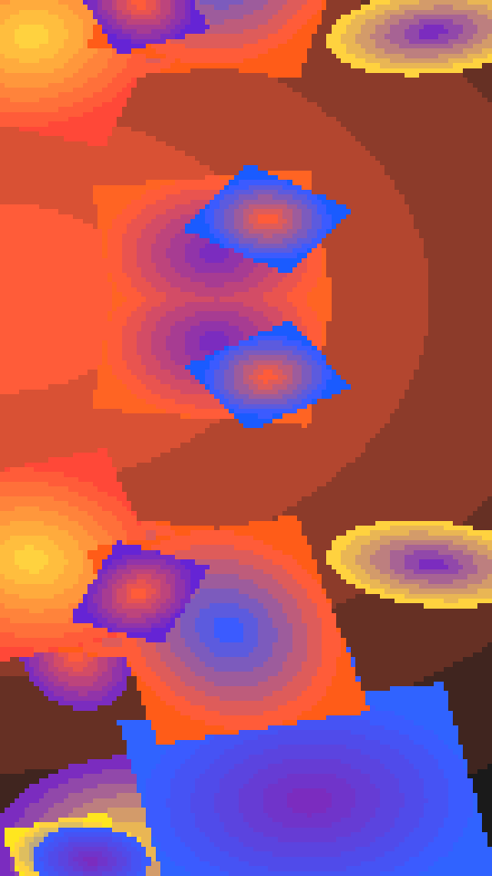

A collage of pixel op-art patches over a stepped burst ground, folded across the sheet so it mirrors like a kaleidoscope. Patches come as zebra stripes, staircases, dot rows, bursts, chevrons or checks.

fold renders a Loop: 36 frames at 12 fps, in which the patches and the ground slide once round a small circle under the folded view. The fold lines stay put, so the patches flow into and out of each mirror. The patches are already off their places at frame 0, so frame 0 differs from the Still. Its site page is [playgrnd.tools/fold](https://www.playgrnd.tools/fold/).

## Still



Seed 2, rendered by:

```sh
tirage derive --seed 2 --tool fold | tirage render --size 540x960 -o fold.png
```

## Loop

<video src="/tools/fold.mp4" width="360" height="640" autoplay loop muted playsinline></video>

The same Seed 2, encoded at 360x640 by:

```sh
tirage derive --seed 2 --tool fold | tirage encode --size 360x640 -o fold.mp4
```

## Parameters

From [`tirage tools`](/cli-reference/tools/), without the 11 shared [dither and grain](/concepts/dither-and-grain/) Parameters:

```
fold  36 frames
  folds       Four ways, Kaleidoscope, Across, Down, None [no Taste]
  kinds       Mixed, Zebra, Staircases, Dot rows, Bursts, Chevrons, Checks [no Taste]
  foldx       0.2..=0.8 step 0.01
  foldy       0.2..=0.8 step 0.01
  patches     1..=16    step 1
  size        0..=1     step 0.01
  scale       0..=1     step 0.01
  wave        0..=1     step 0.01
  levels      2..=8     step 1
  tilt        0..=1     step 0.01
  px          0..=1     step 0.01
```

A Seed draws every Parameter listed, each across its full range. `folds` picks how the sheet mirrors and `foldx` and `foldy` where the fold lines sit. `kinds` picks one patch kind for every patch, or Mixed for a different kind each. `px` sets the size of the pixel grid, and `levels` how many tones a burst steps through.

The Palette takes any number of inks from 2. Ink 0 is the ground. Zebra stripes use the darkest and lightest inks, and the other patches take two inks from the third ink on.
