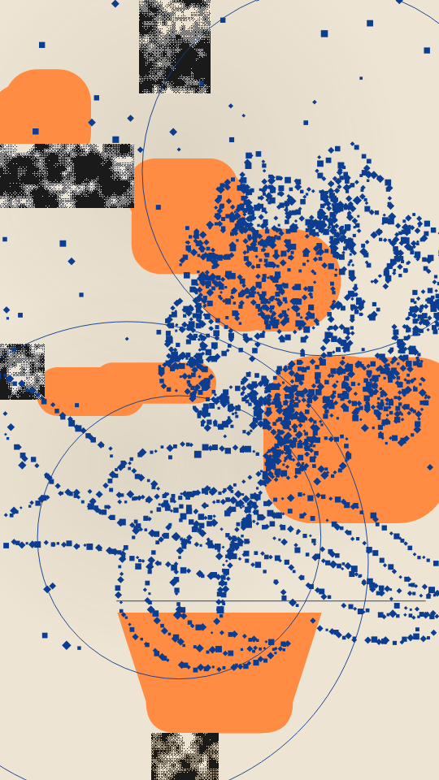

A paste-up of a plant. Soft shadows and a few rounded paper cut-outs sit on a sheet. Torn blocks of ordered 1-bit noise bite in from the edges. Over them a plant is drawn as a broken line of tiny squares and diamonds, then a few thin registration circles and rules go over the top.

frond renders a Loop: 36 frames at 12 fps. Each frame deals the marks of the plant and the noise blocks again, while the cut-outs, the pot and the registration stay put. Frame 0 is the Still. Its site page is [playgrnd.tools/frond](https://www.playgrnd.tools/frond/).

## Still



Seed 5, rendered by:

```sh
tirage derive --seed 5 --tool frond | tirage render --size 540x960 -o frond.png
```

## Loop

<video src="/tools/frond.mp4" width="360" height="640" autoplay loop muted playsinline></video>

The same Seed 5, encoded at 360x640 by:

```sh
tirage derive --seed 5 --tool frond | tirage encode --size 360x640 -o frond.mp4
```

## Parameters

From [`tirage tools`](/cli-reference/tools/), without the 11 shared [dither and grain](/concepts/dither-and-grain/) Parameters:

```
frond  36 frames
  dirs        Potted, Bouquet, Fronds [no Taste]
  masses      0..=6     step 1
  size        0..=1     step 0.01
  round       0..=1     step 0.01
  growth      0..=1     step 0.01
  detail      0..=1     step 0.01
  coarse      0..=1     step 0.01
  breakup     0..=1     step 0.01
  noise       0..=1     step 0.01
  patch       0..=1     step 0.01
  circles     0..=1     step 0.01
  rules       0..=1     step 0.01
```

A Seed draws `dirs`, `masses`, `size`, `round`, `growth`, `detail`, `coarse`, `breakup`, `noise`, `patch`, `circles` and `rules`. Each range comes from its [Taste bounds](/concepts/taste-bounds/), which sit within the range listed.
