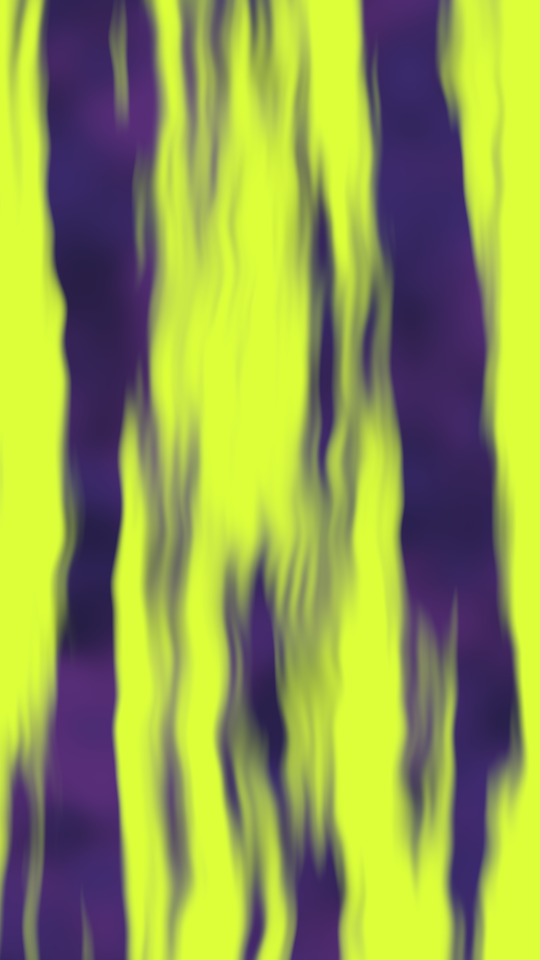

A neon spray over a soft pastel ground. Three ground inks blot into each other, then a curtain of tall, ragged streaks in the first ink bleeds over them. The field is painted on a small buffer with a fine grain and scaled up smooth.

mist renders a Loop: 72 frames at 12 fps, in which the neon curtain sways once round a circle while the ground blots drift round a smaller one beneath it. The grain holds still. Both layers are already shifted at frame 0, so frame 0 differs from the Still. Its site page is [playgrnd.tools/mist](https://www.playgrnd.tools/mist/).

## Still



Seed 6, rendered by:

```sh
tirage derive --seed 6 --tool mist | tirage render --size 540x960 -o mist.png
```

## Loop

<video src="/tools/mist.mp4" width="360" height="640" autoplay loop muted playsinline></video>

The same Seed 6, encoded at 360x640 by:

```sh
tirage derive --seed 6 --tool mist | tirage encode --size 360x640 -o mist.mp4
```

## Parameters

From [`tirage tools`](/cli-reference/tools/), without the 11 shared [dither and grain](/concepts/dither-and-grain/) Parameters:

```
mist  72 frames
  streaks     0.4..=2   step 0.05
  cover       0.2..=0.85 step 0.01
  soft        0.1..=1   step 0.01
  blot        0.2..=1   step 0.01
  grain       0..=1     step 0.01 [no Taste]
```

A Seed draws `streaks`, `cover`, `soft` and `blot`. Each range comes from its [Taste bounds](/concepts/taste-bounds/), which sit within the range listed. `grain`, the Tool's own per-pixel noise, stays at 0.4. mist takes at most 4 inks: the first is the neon, the other three the ground.
