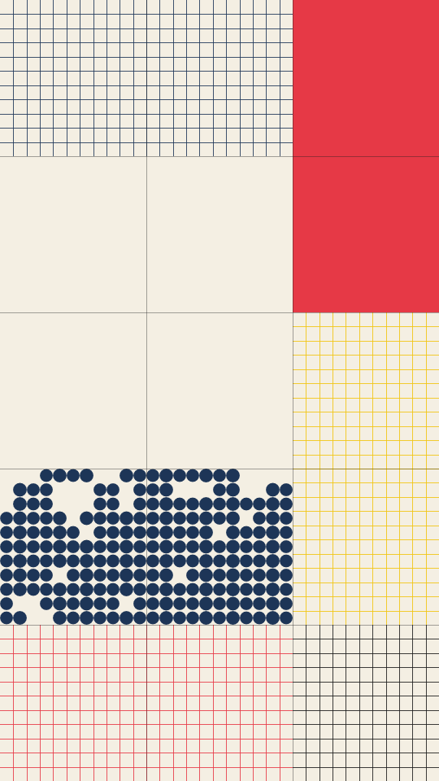

A grid poster in the Swiss style. The frame is cut into modules, and some of them span two cells. Each module is left empty, filled flat, filled with a ramp between two inks, scattered with blocks, packed with dots in one corner, or ruled like graph paper. Thin rules run over the whole grid.

modular renders a Loop: 24 frames at 6 fps, in which the cells of the block and dot modules switch on and off as a noise field drifts past their threshold, then come back. The layout, the inks and the rules hold still. The cells have already switched at frame 0, so frame 0 differs from the Still. Its site page is [playgrnd.tools/modular](https://www.playgrnd.tools/modular/).

## Still



Seed 1, rendered by:

```sh
tirage derive --seed 1 --tool modular | tirage render --size 540x960 -o modular.png
```

SVG: yes. `-o modular.svg` writes this Still as an [SVG](/cli-reference/render/#svg).

## Loop

<video src="/tools/modular.mp4" width="360" height="640" autoplay loop muted playsinline></video>

The same Seed 1, encoded at 360x640 by:

```sh
tirage derive --seed 1 --tool modular | tirage encode --size 360x640 -o modular.mp4
```

## Parameters

From [`tirage tools`](/cli-reference/tools/), without the 11 shared [dither and grain](/concepts/dither-and-grain/) Parameters:

```
modular  24 frames, svg
  gcols       2..=12    step 1
  unit        2..=12    step 1
  merge       0..=1     step 0.01
  wEmpty      0..=100   step 1
  wSolid      0..=100   step 1
  wBlocks     0..=100   step 1
  wDots       0..=100   step 1
  wLines      0..=100   step 1
  wGrad       0..=100   step 1
  blockFill   0.1..=0.9 step 0.01
  dot         0.2..=1   step 0.01
  rules       0..=1     step 0.01
  ruleW       0.5..=4   step 0.5
```

A Seed draws every Parameter listed, each across its full range. `gcols` is the number of grid columns, and the rows follow from the frame's shape. `unit` is how many small cells cross one module, and `merge` is the chance that a module spans two cells. The six weights, `wEmpty` to `wGrad`, decide how often each kind of module turns up. `blockFill` is the share of small cells that blocks and dots fill, and `dot` is the dot size. `rules` is how strongly the grid rules show, and `ruleW` is the width of every rule.

The Palette takes any number of inks from 2, read by position. Each module picks one ink, plus a second for its ramp or its backing panel. The cream ground and the near-black rules are fixed by modular and are not part of the Palette.
