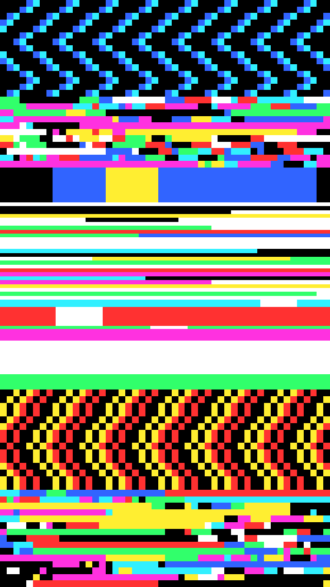

A stack of horizontal bands of broken video data, each a different failure: confetti runs, a torn mosaic, long smears, whole scan rows, and a chevron shear. Every band is flat rectangles in a few hard inks, with a share of the frame fallen to the darkest ink.

mosh renders a Loop: 24 frames at 12 fps, in which every band deals its runs, blocks, tears, rows and chevrons again each frame while the bands keep their heights and kinds. Frame 0 is the Still. Its site page is [playgrnd.tools/mosh](https://www.playgrnd.tools/mosh/).

## Still



Seed 17, rendered by:

```sh
tirage derive --seed 17 --tool mosh | tirage render --size 540x960 -o mosh.png
```

SVG: yes. `-o mosh.svg` writes this Still as an [SVG](/cli-reference/render/#svg).

## Parameters

As [`tirage tools`](/cli-reference/tools/) lists them, each with its range and step, or its choices:

```
mosh  24 frames, svg
  bands       1..=14    step 1
  cols        24..=420  step 2
  mix         0..=1     step 0.01
  tears       0..=1     step 0.01
  runs        0..=1     step 0.01
  bright      0..=1     step 0.01
  ditherTog   on/off
  dthKinds    Bayer 8, Bayer 4, Noise
  dthSize     1..=10    step 1
  dthLevels   2..=8     step 1
  dthAmount   0..=1     step 0.05
  grainTog    on/off
  grnBlends   Add, Overlay, Soft light, Multiply, Screen
  grnAmount   0..=1     step 0.05
  grnSize     0.5..=4   step 0.1
  grnSpecks   0..=1     step 0.05
  grnVignette 0..=1     step 0.05
```

A Seed draws all 6 art Parameters. Each range comes from its [Taste bounds](/concepts/taste-bounds/), which sit within the range listed. Dither and the grain post-pass stay off.

The Palette takes any number of inks from 2, picked by position. The second ink cuts in as the bright strips, and the darkest ink fills the dead patches.
