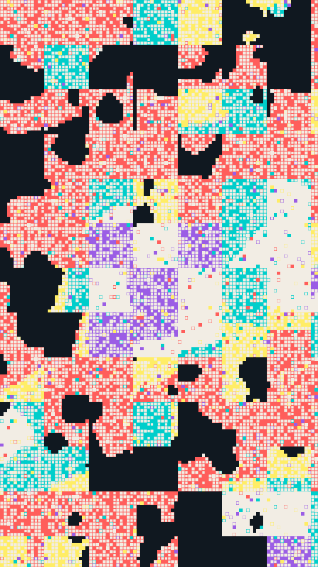

A patchwork of hard-edged pixel regions on a coarse grid. Three noise fields decide each cell: one picks its colour, one decides whether it is filled at all, and a fine one breaks the region edges into pixels. Blocks of cells can be pulled toward a tone of their own, so the regions square off into a quilt. Some filled cells carry a small motif.

oddgrid renders a Loop: 32 frames at 8 fps, in which all three fields shift shape and come back, so regions change colour, grow, shrink and fray in place. The grid, the block tones and the motifs hold still. The fields have already shifted at frame 0, so frame 0 differs from the Still. Its site page is [playgrnd.tools/oddgrid](https://www.playgrnd.tools/oddgrid/).

## Still



Seed 4, rendered by:

```sh
tirage derive --seed 4 --tool oddgrid | tirage render --size 540x960 -o oddgrid.png
```

SVG: yes. `-o oddgrid.svg` writes this Still as an [SVG](/cli-reference/render/#svg).

## Parameters

From [`tirage tools`](/cli-reference/tools/), without the 11 shared [dither and grain](/concepts/dither-and-grain/) Parameters:

```
oddgrid  32 frames, svg
  cols        12..=110  step 1
  scale       2..=60    step 0.5
  density     0..=1     step 0.01
  grain       0..=1.4   step 0.01
  variety     0..=1.6   step 0.01
  block       0..=1     step 0.01
  bsize       2..=16    step 1
  speck       0..=0.6   step 0.01
  motifs      None, Dot, Ring, Square, Wedge, Mixed
  motifAmt    0..=1     step 0.01
  markSize    0.15..=1  step 0.01
  balance     -1.2..=1.2 step 0.05
```

A Seed draws `motifs` and all 11 art ranges. Each range comes from its [Taste bounds](/concepts/taste-bounds/), which sit within the range listed: `density` starts at 0.4, because below it the grid empties to bare ground, and `speck` stops at 0.45, past which the frame turns to noise. The `grain` among the art ranges is the Tool's own: it breaks up region edges. The site page also offers a motif from an uploaded SVG and a few Looks that set several sliders at once. tirage leaves both out.

The Palette is the cell inks, any number from 2. `balance` leans the colour field toward the first or the last of them. The ground `#101820` and the motif ink `#f2ede4` are fixed, as on the site page by default.
