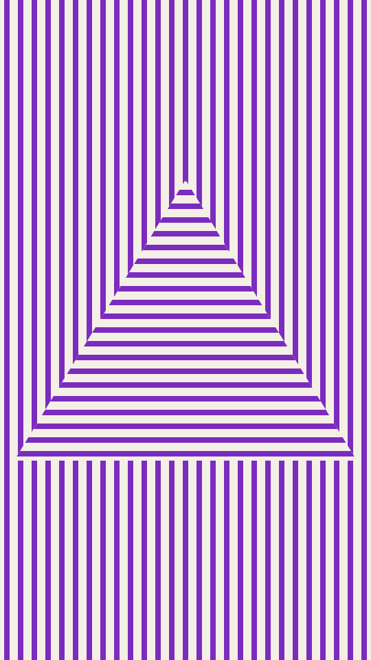

Even vertical bars fill the frame. Up to three nested figures sit on its centre, and inside each one the bars run again, moved against the bars around it. They shift half a bar, turn to horizontal, or tilt 45° either way.

optic renders a Loop: 72 frames at 12 fps, in which the bars slide two repeats along their own direction, each figure against the bars around it, while the figures and inks hold. Frame 0 is the Still. Its site page is [playgrnd.tools/optic](https://www.playgrnd.tools/optic/).

## Still



Seed 1, rendered by:

```sh
tirage derive --seed 1 --tool optic | tirage render --size 540x960 -o optic.png
```

SVG: yes. `-o optic.svg` writes this Still as an [SVG](/cli-reference/render/#svg).

## Loop

<video src="/tools/optic.mp4" width="360" height="640" autoplay loop muted playsinline></video>

The same Seed 1, encoded at 360x640 by:

```sh
tirage derive --seed 1 --tool optic | tirage encode --size 360x640 -o optic.mp4
```

## Parameters

From [`tirage tools`](/cli-reference/tools/), without the 11 shared [dither and grain](/concepts/dither-and-grain/) Parameters:

```
optic  72 frames, svg
  styles      Auto, Diamond, Circle, Peak, Square
  count       6..=28    step 1
  weight      0.3..=0.7 step 0.01
  sizeF       0.4..=1   step 0.01
  levels      1..=3     step 1
```

A Seed draws every Parameter listed, each across its full range. `styles` is the figure shape. Auto lets the Tool seed pick the shape, and it also changes how the bars move inside each figure, so Auto gives a different Still from naming the same shape. `count` sets how many bars cross the short edge and `weight` how much of each step is bar. `sizeF` sets the size of the outer figure and `levels` how many figures nest inside one another.

The Palette has 2 inks by role: Base and Ink. optic takes at most 2. The Base is the ground and the Ink is every bar.
