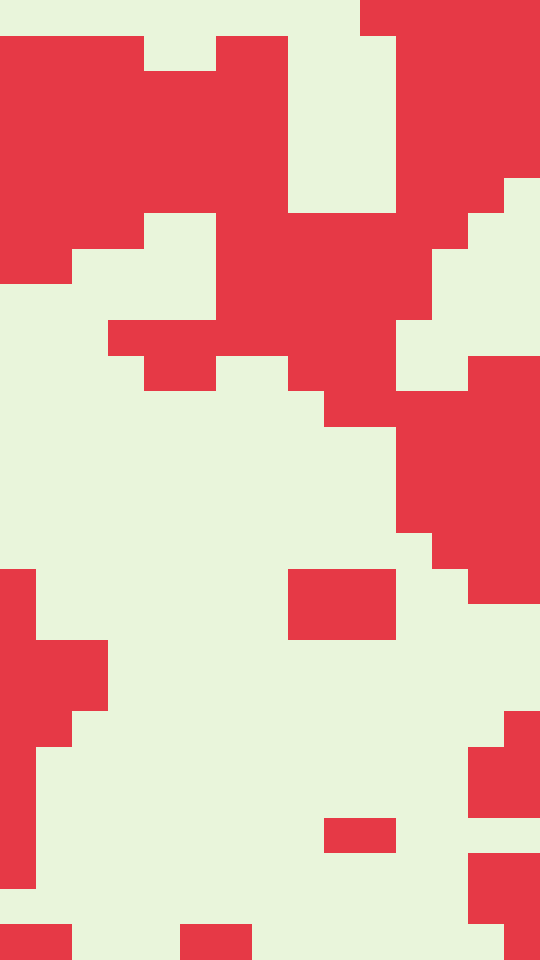

A survey map. Blocks of one ink spread across a plain ground on a coarse cell grid, the way plots sit on a land registry sheet. A few small grids of hairlines float on top, each a ragged cluster of cells. By default the lines multiply onto what they cross, so they read darker over the blocks than over the ground.

parcel renders a Loop: 72 frames at 12 fps, in which the block field shifts to a new place five times, each step held for about 14 frames, and comes back round to where it started. The grid, the hairline clusters and the inks hold still. Frame 0 is the first step, so it matches the Still. Its site page is [playgrnd.tools/parcel](https://www.playgrnd.tools/parcel/).

## Still



Seed 1, rendered by:

```sh
tirage derive --seed 1 --tool parcel | tirage render --size 540x960 -o parcel.png
```

SVG: yes. `-o parcel.svg` writes this Still as an [SVG](/cli-reference/render/#svg).

## Loop

<video src="/tools/parcel.mp4" width="360" height="640" autoplay loop muted playsinline></video>

The same Seed 1, encoded at 360x640 by:

```sh
tirage derive --seed 1 --tool parcel | tirage encode --size 360x640 -o parcel.mp4
```

## Parameters

From [`tirage tools`](/cli-reference/tools/), without the 11 shared [dither and grain](/concepts/dither-and-grain/) Parameters:

```
parcel  72 frames, svg
  cells       8..=28    step 1
  cover       0.2..=0.8 step 0.01
  chunk       0.5..=2   step 0.05
  grids       0..=8     step 1
  blends      Multiply, Normal [no Taste]
```

A Seed draws `cells`, `cover`, `chunk` and `grids` across their full range. `cells` is how many cells span the frame, `cover` is the share of them the blocks take, and `chunk` decides how big the blobs grow. `grids` is how many hairline clusters there are, so Seed 1, which draws 0, has none. `blends` stays at Multiply. Switch it to Normal and the lines are drawn flat over the blocks.

The Palette has three inks, one per role: the ground, the blocks and the lines. parcel takes at most 3.
