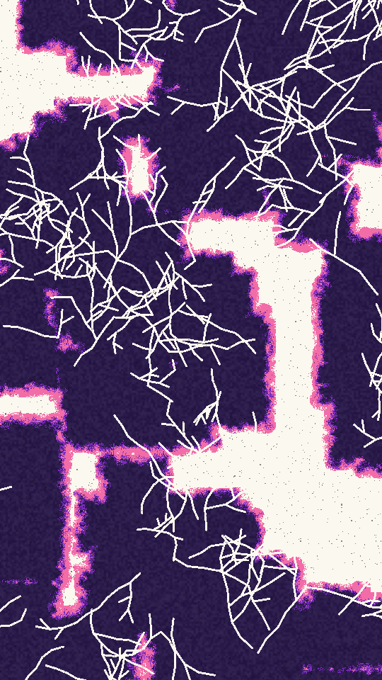

Cut-tissue cells on a paper ground. Each cell is a cluster of rounded boxes with a lumpy, ragged outline, banded from its edge inward: an outer band, a thin rim, then a mottled core. Branching veins carve the ground back through each cell, and speckle blurs the bands into one another.

pith renders a Loop: 36 frames at 12 fps, in which the speckle, band edges, core mottle and flecks are dealt again every frame while the cells and veins stay put. Frame 0 is the Still. Its site page is [playgrnd.tools/pith](https://www.playgrnd.tools/pith/).

## Still



Seed 14, rendered by:

```sh
tirage derive --seed 14 --tool pith | tirage render --size 540x960 -o pith.png
```

## Loop

<video src="/tools/pith.mp4" width="360" height="640" autoplay loop muted playsinline></video>

The same Seed 14, encoded at 360x640 by:

```sh
tirage derive --seed 14 --tool pith | tirage encode --size 360x640 -o pith.mp4
```

## Parameters

From [`tirage tools`](/cli-reference/tools/), without the 11 shared [dither and grain](/concepts/dither-and-grain/) Parameters:

```
pith  36 frames
  count       1..=60    step 1
  size        0..=1     step 0.01
  zoom        1..=8     step 0.1
  round       0..=1     step 0.01
  wobble      0..=1     step 0.01
  band        0..=1     step 0.01
  dither      0..=1     step 0.01
  veins       0..=1     step 0.01
  thick       0..=1     step 0.01
  grain       0..=1     step 0.01
```

A Seed draws `count`, `size`, `zoom`, `round`, `wobble`, `band`, `veins` and `thick`. Each range comes from its [Taste bounds](/concepts/taste-bounds/), which sit within the range listed. `dither`, the speckle across band edges, stays at 0.55, and `grain`, the Tool's own flecks, at 0.4.

The Palette is read by position: ground, outer band, rim, core, then the grain flecks. A shorter Palette reuses the second ink for the missing ones.
