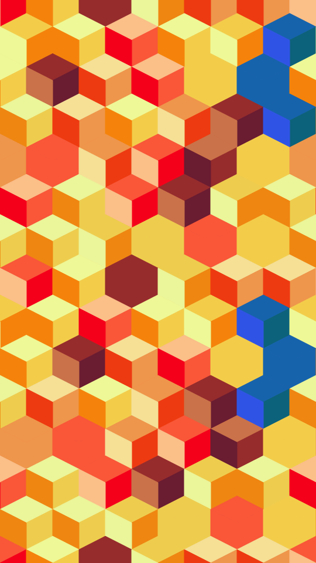

Tumbling blocks. Cubes seen from a corner tile the frame, each one a hexagon cut into a top, a left and a right face. The three faces are one ink at three lightnesses, so a flat shape reads as a lit solid. A small block of cubes is worked out once and repeated. Some cubes have their three tones turned round, which breaks the plain field into hooks. Some are painted in one flat tone, and some take an accent ink.

relief renders a Loop: 24 frames at 6 fps, in which about 3 in 10 cubes of the repeated block are dealt again every frame, with a new turn of their tones, a new flat or shaded look and a new accent, while the other cubes stay put. Frame 0 is the Still. Its site page is [playgrnd.tools/relief](https://www.playgrnd.tools/relief/).

## Still



Seed 2, rendered by:

```sh
tirage derive --seed 2 --tool relief | tirage render --size 540x960 -o relief.png
```

SVG: yes. `-o relief.svg` writes this Still as an [SVG](/cli-reference/render/#svg).

## Loop

<video src="/tools/relief.mp4" width="360" height="640" autoplay loop muted playsinline></video>

The same Seed 2, encoded at 360x640 by:

```sh
tirage derive --seed 2 --tool relief | tirage encode --size 360x640 -o relief.mp4
```

## Parameters

From [`tirage tools`](/cli-reference/tools/), without the 11 shared [dither and grain](/concepts/dither-and-grain/) Parameters:

```
relief  24 frames, svg
  scale       12..=180  step 1
  repeat      1..=12    step 1
  variety     0..=1     step 0.01
  solids      0..=1     step 0.01
  relief      0..=1     step 0.01
  accent      0..=1     step 0.01
```

A Seed draws every Parameter listed. Each range comes from its [Taste bounds](/concepts/taste-bounds/), which sit within the range listed: `scale` stays within 12..=120 and `solids` within 0..=0.75. `scale` is the cube size in pixels and `repeat` the cubes per side of the repeated block. The first ink paints most cubes, and every later ink is an accent.
