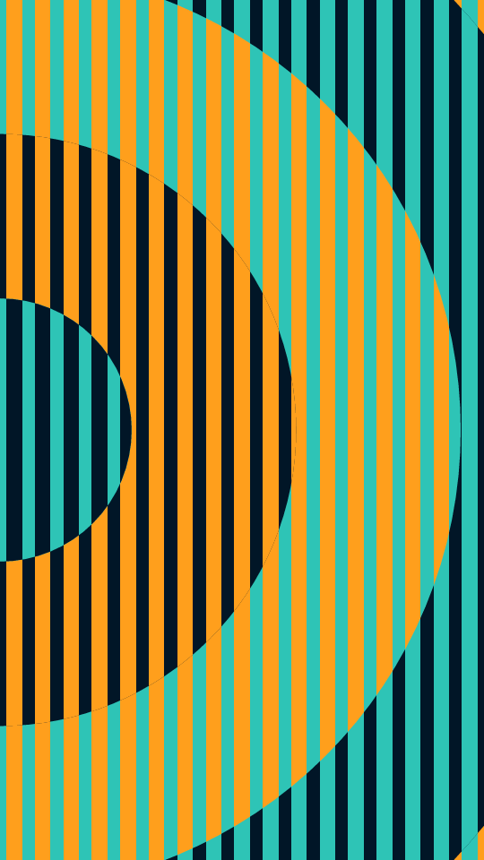

Even vertical bars fill the frame. Large concentric bands rise from one anchor over them, and each band trades which two inks are its ground and its bars. Every band shares the same bar grid, so the stripes line up from one band to the next.

rise renders a Loop: 72 frames at 12 fps, in which each band swells and shrinks once, a little after the band inside it, so the swell travels out from the anchor. The bars and inks hold still. At frame 0 only the innermost band sits where the Still has it, so frame 0 differs from the Still unless there is a single band. Its site page is [playgrnd.tools/rise](https://www.playgrnd.tools/rise/).

## Still



Seed 1, rendered by:

```sh
tirage derive --seed 1 --tool rise | tirage render --size 540x960 -o rise.png
```

SVG: yes. `-o rise.svg` writes this Still as an [SVG](/cli-reference/render/#svg).

## Loop

<video src="/tools/rise.mp4" width="360" height="640" autoplay loop muted playsinline></video>

The same Seed 1, encoded at 360x640 by:

```sh
tirage derive --seed 1 --tool rise | tirage encode --size 360x640 -o rise.mp4
```

## Parameters

From [`tirage tools`](/cli-reference/tools/), without the 11 shared [dither and grain](/concepts/dither-and-grain/) Parameters:

```
rise  72 frames, svg
  styles      Bottom, Top, Left, Right, Centre [no Taste]
  count       6..=28    step 1
  weight      0.3..=0.7 step 0.01
  bands       1..=8     step 1
  depth       0.1..=0.4 step 0.01
```

A Seed draws every Parameter listed, each across its full range. `styles` is the anchor the bands rise from: the middle of an edge, or the centre of the frame. The site's Auto anchor is left out: it picks one from the Tool seed, so a Recipe names that anchor instead. `count` sets how many bars cross the short edge and `weight` how much of each step is bar. `bands` sets how many bands there are and `depth` how thick each one is.

The Palette has 3 inks by role: Field, Bars and Accent. rise takes at most 3. The Field and Bars inks paint the ground outside the bands, and the bands cycle through the other pairings of the three.
