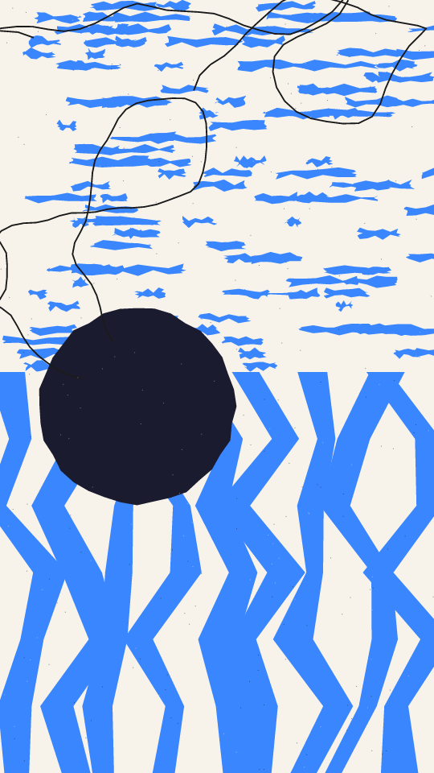

A risograph collage. The frame is stacked into horizontal bands, and each band is printed in two inks: a ground and a pattern of torn paper on it. The pattern is ragged blocks, wavy streaks or rows of short scratchy dashes. A big dot with a torn edge may sit over one band, thin pen lines wander across the sheet, and light and dark specks lie over everything.

riso renders a Loop: 16 frames at 8 fps, in which every torn edge and streak sways out and back once, each on its own beat. The bands, inks, dot, pen lines and specks hold still. The sway is already under way at frame 0, so frame 0 differs from the Still. Its site page is [playgrnd.tools/riso](https://www.playgrnd.tools/riso/).

## Still



Seed 1, rendered by:

```sh
tirage derive --seed 1 --tool riso | tirage render --size 540x960 -o riso.png
```

SVG: yes. `-o riso.svg` writes this Still as an [SVG](/cli-reference/render/#svg).

## Parameters

From [`tirage tools`](/cli-reference/tools/), without the 11 shared [dither and grain](/concepts/dither-and-grain/) Parameters:

```
riso  16 frames, svg
  bands       2..=5     step 1
  rough       0.1..=1   step 0.01
  scrib       0..=1     step 0.01
  dotp        0..=1     step 0.01
  grain       0..=1     step 0.01
```

A Seed draws `bands`, `rough`, `scrib` and `dotp`, each across its full range. `bands` sets how many bands there are and `rough` how torn the edges look. `scrib` sets how many pen lines cross the sheet, up to 3, and `dotp` is the chance of the big dot.

`grain` is riso's own layer of specks, not the shared grain pass. A Seed leaves it at 0.5, as the site page opens it.

The Palette takes any number of inks from 2. Each band picks its ground from it, then a pattern ink that stands out from the ground in lightness. The pen ink and the specks are riso's own colours, not part of the Palette.
