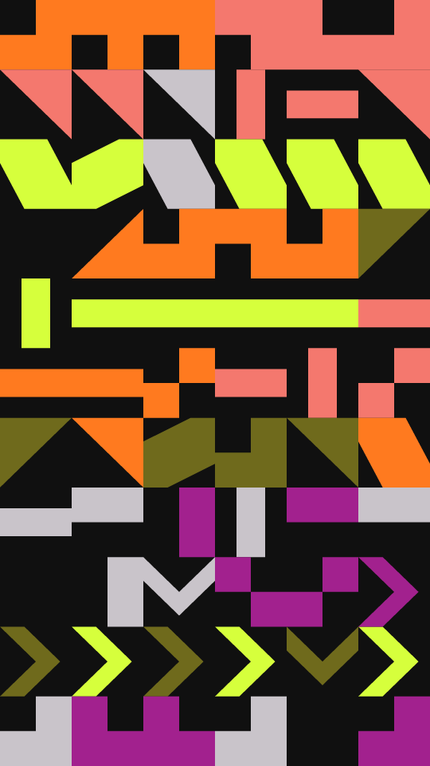

A sampler of flat, straight-edged marks. The frame is a grid of cells cut into horizontal bands. Each band uses one to a few tile shapes: triangles, diagonals, bars, elbows, steps, halves, notches or arrows. It fills its cells with them in two inks, and turns each tile a quarter at a time. The darkest ink is the ground and shows through the empty cells.

sampler renders a Loop: 24 frames at 6 fps, in which every frame deals new bands, with new shapes, inks and tiles, on the same grid and ground. Frame 0 is the Still. Its site page is [playgrnd.tools/sampler](https://www.playgrnd.tools/sampler/).

## Still



Seed 1, rendered by:

```sh
tirage derive --seed 1 --tool sampler | tirage render --size 540x960 -o sampler.png
```

SVG: yes. `-o sampler.svg` writes this Still as an [SVG](/cli-reference/render/#svg).

## Loop

<video src="/tools/sampler.mp4" width="360" height="640" autoplay loop muted playsinline></video>

The same Seed 1, encoded at 360x640 by:

```sh
tirage derive --seed 1 --tool sampler | tirage encode --size 360x640 -o sampler.mp4
```

## Parameters

From [`tirage tools`](/cli-reference/tools/), without the 11 shared [dither and grain](/concepts/dither-and-grain/) Parameters:

```
sampler  24 frames, svg
  grid        4..=48    step 1
  bands       1..=14    step 1
  mix         0..=1     step 0.01
  turn        0..=1     step 0.01
  density     0.1..=1   step 0.01
  weight      0..=1     step 0.01
```

A Seed draws every Parameter listed. `grid` sets the number of columns, and the rows follow from the frame's shape. `bands` sets how many bands the rows aim for, and `mix` how many tile shapes one band may use. `turn` sets how freely a tile turns away from its neighbours, and `weight` tips each band toward its first ink.

`density` is the share of cells that get a tile. A Seed draws it from 0.55 to 1: below that, most of the frame is bare ground with a few small marks scattered on it.

The Palette takes any number of inks. The darkest one is the ground, and each band picks its two tile inks from the rest.
