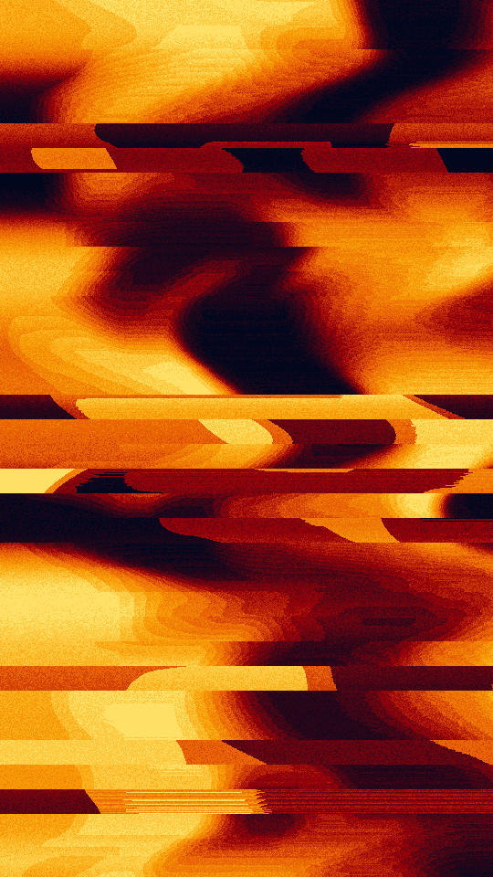

A smeared thermal image. A warped noise field is spread flat so each ink of the ramp covers about the same share of the frame, then cut into flat blocks. Each row holds a colour until the field changes enough, so edges drag into streaks, and some bands of rows tear sideways.

sear renders a Loop: 36 frames at 12 fps, in which the heat field drifts once round a small circle under the smears, so the blocks of colour change shape while each ink keeps about the same share of the frame. The smears, the torn bands and the grain hold still. The field has already moved at frame 0, so frame 0 differs from the Still. Its site page is [playgrnd.tools/sear](https://www.playgrnd.tools/sear/).

## Still



Seed 12, rendered by:

```sh
tirage derive --seed 12 --tool sear | tirage render --size 540x960 -o sear.png
```

## Loop

<video src="/tools/sear.mp4" width="360" height="640" autoplay loop muted playsinline></video>

The same Seed 12, encoded at 360x640 by:

```sh
tirage derive --seed 12 --tool sear | tirage encode --size 360x640 -o sear.mp4
```

## Parameters

From [`tirage tools`](/cli-reference/tools/), without the 11 shared [dither and grain](/concepts/dither-and-grain/) Parameters:

```
sear  36 frames
  scale       0..=1     step 0.01
  warp        0..=1     step 0.01
  detail      1..=5     step 1
  smear       0..=1     step 0.01
  drag        0..=1     step 0.01
  tear        0..=1     step 0.01
  steps       2..=24    step 1
  grain       0..=1     step 0.01 [no Taste]
```

A Seed draws every Parameter above `grain`. Each range comes from its [Taste bounds](/concepts/taste-bounds/), which sit within the range listed: `tear` stays within 0..=0.6. `grain`, the Tool's own grain, stays at 0.1. The Palette is a ramp read coolest first, so the first ink is the lowest heat and the last the peaks.
