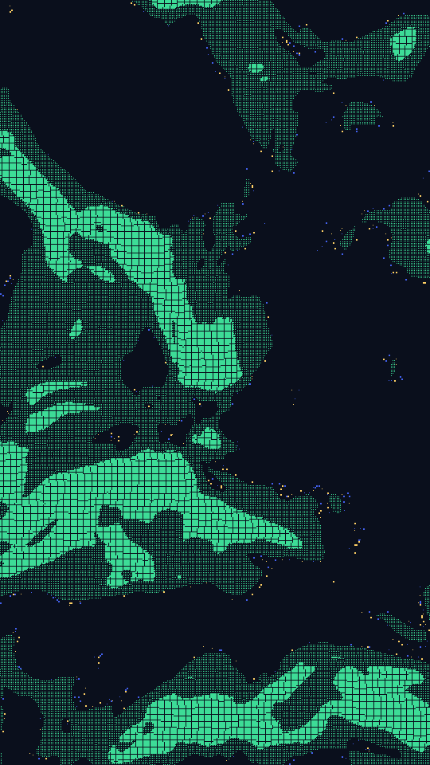

A one-bit chart of a coastline. A smooth random height field is cut at a water level. Land above the cut is a grid of square dots, sized by how far inland they sit. A thin band either side of the cut breaks up into sparse coloured specks.

sonar renders a Loop: 24 frames at 10 fps. The land keeps its shape while the water level rises and falls once per Loop, so the coast moves in and out. Frame 0 is the Still. Its site page is [playgrnd.tools/sonar](https://www.playgrnd.tools/sonar/).

## Still



Seed 1, rendered by:

```sh
tirage derive --seed 1 --tool sonar | tirage render --size 540x960 -o sonar.png
```

SVG: yes. `-o sonar.svg` writes this Still as an [SVG](/cli-reference/render/#svg).

## Parameters

From [`tirage tools`](/cli-reference/tools/), without the 11 shared [dither and grain](/concepts/dither-and-grain/) Parameters:

```
sonar  24 frames, svg
  level       0..=1     step 0.01
  scale       1..=10    step 0.1
  warp        0..=1     step 0.01
  grid        40..=320  step 2
  depth       0..=1     step 0.01
  fringe      0..=1     step 0.01
  spark       0..=1     step 0.01
```

A Seed draws `level`, `scale`, `warp`, `grid`, `depth`, `fringe` and `spark`. Each range comes from its [Taste bounds](/concepts/taste-bounds/), which sit within the range listed.
