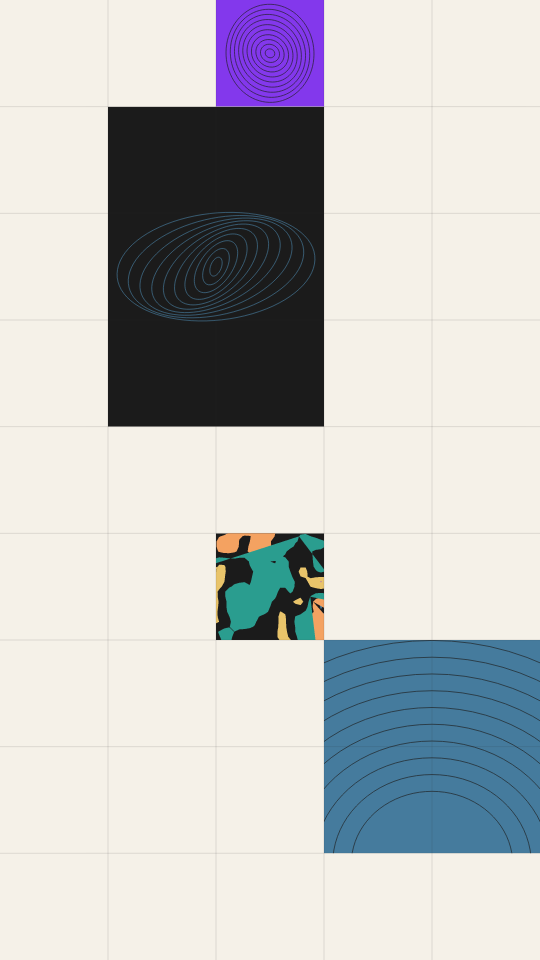

A specimen sheet on a pale page. Blocks fill some cells of a square grid and leave others bare, and some blocks span two to four cells. Each block shows one motif: marbled bands, wandering tendrils, looped ellipses, flat colour, nested rings, a fan of blades, stacked arcs or scattered spikes. Thin rules mark the grid over the whole sheet.

specimen renders a Loop: 24 frames at 12 fps, in which the marbled bands and the tendrils reshape and come back. Every other block holds still, so a sheet with neither motif does not move. The marbling and tendrils have already changed at frame 0, so frame 0 differs from the Still. Its site page is [playgrnd.tools/specimen](https://www.playgrnd.tools/specimen/).

## Still



Seed 1, rendered by:

```sh
tirage derive --seed 1 --tool specimen | tirage render --size 540x960 -o specimen.png
```

SVG: yes. `-o specimen.svg` writes this Still as an [SVG](/cli-reference/render/#svg).

## Loop

<video src="/tools/specimen.mp4" width="360" height="640" autoplay loop muted playsinline></video>

The same Seed 1, encoded at 360x640 by:

```sh
tirage derive --seed 1 --tool specimen | tirage encode --size 360x640 -o specimen.mp4
```

## Parameters

From [`tirage tools`](/cli-reference/tools/), without the 11 shared [dither and grain](/concepts/dither-and-grain/) Parameters:

```
specimen  24 frames, svg
  cols        2..=16    step 1
  fill        0.1..=1   step 0.01
  span        0..=1     step 0.01
  gut         0..=0.3   step 0.005
  rules       0..=1     step 0.01
  wMarble     0..=100   step 1
  wTendril    0..=100   step 1
  wLoop       0..=100   step 1
  wFlat       0..=100   step 1
  wRing       0..=100   step 1
  wFan        0..=100   step 1
  wArc        0..=100   step 1
  wSpike      0..=100   step 1
  mScale      0.6..=6   step 0.1
  mBands      2..=7     step 1
  density     0.1..=1   step 0.01
  lineW       0.4..=10  step 0.2
  inkMix      0..=1     step 0.01
```

A Seed draws every Parameter listed, each across its full range. `cols` sets the grid's columns, and the rows follow the frame so every cell is square. `fill` is the chance a cell starts a block and `span` the chance a block grows past one cell. `gut` insets each block and `rules` sets how strongly the grid lines show. The eight weights from `wMarble` to `wSpike` set how often each motif turns up. `mScale` and `mBands` shape the marbling. `density` sets how many lines or shapes a motif draws, `lineW` how thick its lines are, and `inkMix` how often a block sits on the dark ink instead of a Palette colour.

The Palette takes any number of inks from 2, and blocks pick from it by position, wrapping around. The page `#F5F1E8` and the dark ink `#1B1B1B` are fixed by the Tool and are not part of the Palette.
