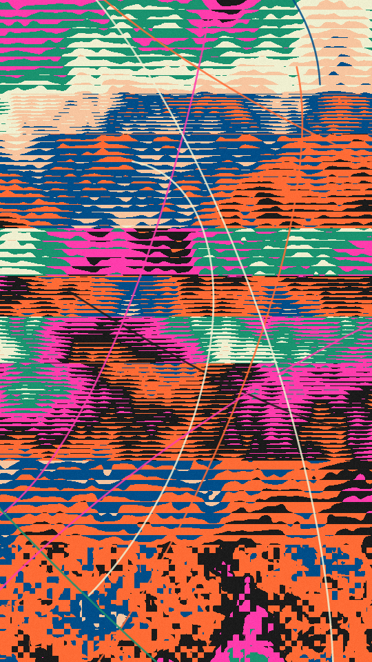

A screen-printed collage. One field of soft hills is cut into tones, with a dark line where two tones meet. The sheet is then cut into slices, and each slice prints the same field shifted along, through its own screen and its own turn of the inks. A few long arcs are drawn over the top.

splice renders a Loop: 36 frames at 12 fps, in which the picture glides once round a small circle under the slices. The cuts, screens and arcs stay put, so the tones flow through the dots and lines. The picture is already off its place at frame 0, so frame 0 differs from the Still. Its site page is [playgrnd.tools/splice](https://www.playgrnd.tools/splice/).

## Still



Seed 2, rendered by:

```sh
tirage derive --seed 2 --tool splice | tirage render --size 540x960 -o splice.png
```

## Loop

<video src="/tools/splice.mp4" width="360" height="640" autoplay loop muted playsinline></video>

The same Seed 2, encoded at 360x640 by:

```sh
tirage derive --seed 2 --tool splice | tirage encode --size 360x640 -o splice.mp4
```

## Parameters

From [`tirage tools`](/cli-reference/tools/), without the 11 shared [dither and grain](/concepts/dither-and-grain/) Parameters:

```
splice  36 frames
  dirs        Columns, Rows, Blocks
  slices      1..=40    step 1
  shift       0..=1     step 0.01
  scale       0..=1     step 0.01
  tones       2..=14    step 1
  key         0..=1     step 0.01
  screen      0..=1     step 0.01
  mix         0..=1     step 0.01
  grain       0..=1     step 0.01
  arcs        0..=24    step 1
  weight      0..=1     step 0.01
  bend        0..=1     step 0.01
```

A Seed draws every Parameter listed except `grain`, each across its full range. `dirs` cuts the sheet into columns, rows or blocks, and `slices` is how many pieces there are. `mix` is the chance that a piece picks its own screen: dots, lines, noise or flat. `grain`, the Tool's own per-pixel noise, stays at 0.18.

The Palette takes any number of inks from 2. The first ink draws the lines between tones and also prints as a tone. The arcs are drawn in Palette inks at 85% opacity.
