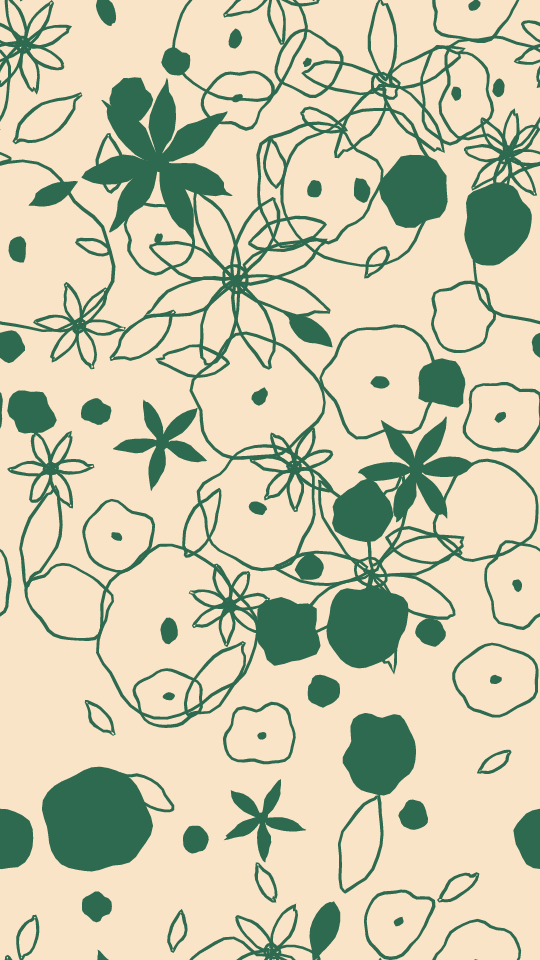

A hand-drawn repeat of little plants. Blooms, leaves, petals, daisies, dots and stems are spread evenly over a plain ground in one ink. Each line swells and thins with a ragged edge, as a marker would lay it down. The pattern tiles: whatever runs off one edge comes back on the other.

sprig renders a Loop: 36 frames at 12 fps, in which the whole pattern slides once round a small oval and wraps at the edges, so a plant that leaves one side comes in on the other. The plants keep their shapes, sizes and turns. The pattern is already off its place at frame 0, so frame 0 differs from the Still. Its site page is [playgrnd.tools/sprig](https://www.playgrnd.tools/sprig/).

## Still



Seed 4, rendered by:

```sh
tirage derive --seed 4 --tool sprig | tirage render --size 540x960 -o sprig.png
```

## Loop

<video src="/tools/sprig.mp4" width="360" height="640" autoplay loop muted playsinline></video>

The same Seed 4, encoded at 360x640 by:

```sh
tirage derive --seed 4 --tool sprig | tirage encode --size 360x640 -o sprig.mp4
```

## Parameters

From [`tirage tools`](/cli-reference/tools/), without the 11 shared [dither and grain](/concepts/dither-and-grain/) Parameters:

```
sprig  36 frames
  dirs        Garden, Blooms, Leaves [no Taste]
  count       2..=120   step 1
  size        0..=1     step 0.01
  vary        0..=1     step 0.01
  solids      0..=1     step 0.01
  weight      0..=1     step 0.01
  rough       0..=1     step 0.01
  wobble      0..=1     step 0.01
  detail      0..=1     step 0.01
```

A Seed draws `dirs` and all 8 art ranges. Each range comes from its [Taste bounds](/concepts/taste-bounds/), which sit within the range listed: `count` runs 20 to 100, `size` up to 0.6 and `weight` up to 0.8, because past them the ink floods the ground. `dirs` picks the mix of motifs: Garden has them all, Blooms leaves out leaves and stems, and Leaves is mostly leaves.

The Palette takes 2 inks: the first is the ground, the second the line. Inks after the second are not drawn.
