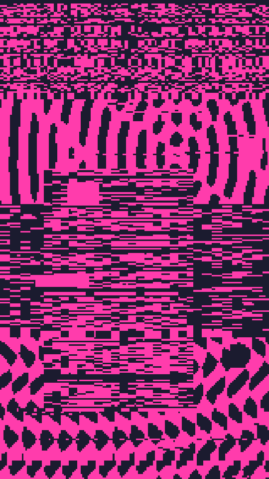

A one-bit glitch poster. The frame splits into stacked bands, each with its own pattern: moire, bars, static noise, blocks, rings or zigzags. Sometimes an inset panel sits on top. A glitch pass then shifts rows, smears them and punches out boxes.

static renders a Loop: 60 frames at 10 fps, in which the static noise, the shifted and smeared rows and the punched-out boxes are dealt again every frame, and the blocks now and then, while the bands and their other patterns stay put. The glitch runs stronger with motion on, so unless glitch is 0, frame 0 differs from the Still. Its site page is [playgrnd.tools/static](https://www.playgrnd.tools/static/).

## Still



Seed 1, rendered by:

```sh
tirage derive --seed 1 --tool static | tirage render --size 540x960 -o static.png
```

SVG: yes. `-o static.svg` writes this Still as an [SVG](/cli-reference/render/#svg).

## Loop

<video src="/tools/static.mp4" width="360" height="640" autoplay loop muted playsinline></video>

The same Seed 1, encoded at 360x640 by:

```sh
tirage derive --seed 1 --tool static | tirage encode --size 360x640 -o static.mp4
```

## Parameters

From [`tirage tools`](/cli-reference/tools/), without the 11 shared [dither and grain](/concepts/dither-and-grain/) Parameters:

```
static  60 frames, svg
  regions     2..=5     step 1
  res         48..=160  step 4
  glitch      0..=1     step 0.01
```

A Seed draws `regions`, `res` and `glitch`, each across its full range. `regions` is how many bands stack down the frame, `res` how many grid columns span it, and `glitch` how hard the glitch pass hits.

The Palette is two inks: the ink, then the ground. static takes at most 2. The site's swap button only reverses them, so swapping the Palette's order does the same.
