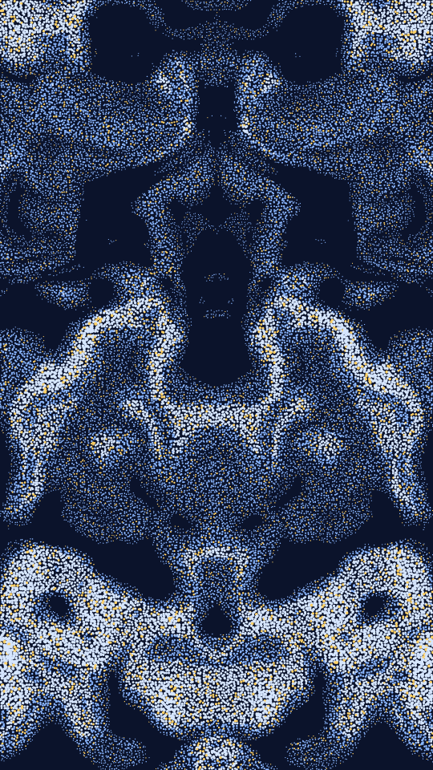

A dot print of a noise field. A warped field is sampled on a square or hex grid, and each sample may become a dot on a dark ground. In Lattice mode the high ground of the field gets dots, larger the higher it is. In Contour mode the dots gather where the field changes fastest, so they trace its contours. The field can be mirrored or folded round the centre, and a few dots take a bright accent.

stipple renders a Loop: 30 frames at 14 fps, in which the field shifts shape and comes back. Each dot stays on its grid cell but grows, shrinks, changes ink or fades out as the field moves under it. The field has already shifted at frame 0, so frame 0 differs from the Still. Its site page is [playgrnd.tools/stipple](https://www.playgrnd.tools/stipple/).

## Still



Seed 15, rendered by:

```sh
tirage derive --seed 15 --tool stipple | tirage render --size 540x960 -o stipple.png
```

SVG: yes. `-o stipple.svg` writes this Still as an [SVG](/cli-reference/render/#svg).

## Loop

<video src="/tools/stipple.mp4" width="360" height="640" autoplay loop muted playsinline></video>

The same Seed 15, encoded at 360x640 by:

```sh
tirage derive --seed 15 --tool stipple | tirage encode --size 360x640 -o stipple.mp4
```

## Parameters

From [`tirage tools`](/cli-reference/tools/), without the 11 shared [dither and grain](/concepts/dither-and-grain/) Parameters:

```
stipple  30 frames, svg
  modesDot    Lattice, Contour
  lattices    Square, Hex
  shapes      Circle, Square
  res         12..=200  step 1
  dot         0.05..=1.4 step 0.01
  vary        0..=1     step 0.01
  cut         0..=0.95  step 0.01
  jit         0..=1     step 0.01
  edge        0..=1     step 0.01
  loose       0..=0.6   step 0.01
  zoom        0.5..=9   step 0.1
  warp        0..=3     step 0.02
  oct         1..=7     step 1
  contrast    0.4..=4   step 0.05
  syms        None, Mirror, Quad, Radial
  folds       2..=16    step 1
  accRate     0..=0.15  step 0.001
```

A Seed draws the 4 choices and all 13 art ranges. Each range comes from its [Taste bounds](/concepts/taste-bounds/), which sit within the range listed: `dot` starts at 0.75, because smaller dots fade into the ground. `cut` only acts in Lattice mode, `edge` and `loose` only in Contour mode, and `folds` only with Radial.

The Palette is the dot inks, any number from 2, taken from low to high ground. The ground `#0b132b` and the accent `#ffd166` are fixed, as on the site page by default.
