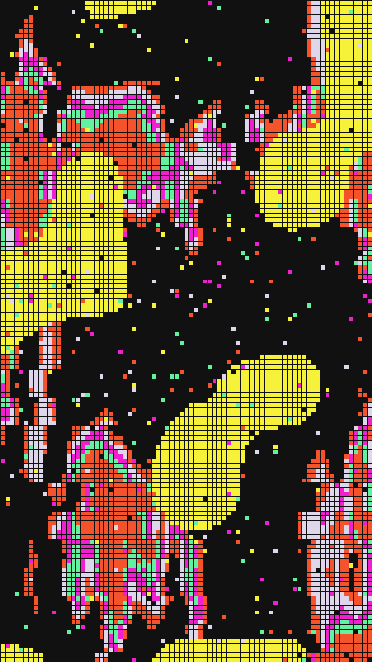

A coarse grid of flat cells with dark gutters, over a noise field smeared into long vertical streaks. Whole rows of cells slip sideways in bands, the way a glitched video frame tears. An accent ink pools into blobs, and a few stray cells take a random ink.

stitch renders a Loop: 36 frames at 12 fps, in which the streaked field and the accent blobs drift once round a small circle. The grid, its torn rows and the stray cells hold still, so only the ink of each cell changes. The field is already shifted at frame 0, so frame 0 differs from the Still. Its site page is [playgrnd.tools/stitch](https://www.playgrnd.tools/stitch/).

## Still



Seed 13, rendered by:

```sh
tirage derive --seed 13 --tool stitch | tirage render --size 540x960 -o stitch.png
```

## Loop

<video src="/tools/stitch.mp4" width="360" height="640" autoplay loop muted playsinline></video>

The same Seed 13, encoded at 360x640 by:

```sh
tirage derive --seed 13 --tool stitch | tirage encode --size 360x640 -o stitch.mp4
```

## Parameters

From [`tirage tools`](/cli-reference/tools/), without the 11 shared [dither and grain](/concepts/dither-and-grain/) Parameters:

```
stitch  36 frames
  cols        16..=96   step 1
  gutter      0..=1     step 0.01
  streak      0..=1     step 0.01
  scale       0..=1     step 0.01
  slip        0..=1     step 0.01
  band        1..=16    step 1
  blobs       0..=1     step 0.01
  blobsize    0..=1     step 0.01
  steps       2..=12    step 1
  ground      0..=1     step 0.01
  stray       0..=1     step 0.01
```

A Seed draws all 11 art Parameters. Each range comes from its [Taste bounds](/concepts/taste-bounds/), which sit within the range listed.

The Palette takes any number of inks from 2. The first ink takes the lowest levels, the second is the blob accent, and the rest fill the middle levels in a shuffled order. The gutter takes the darkest ink.
