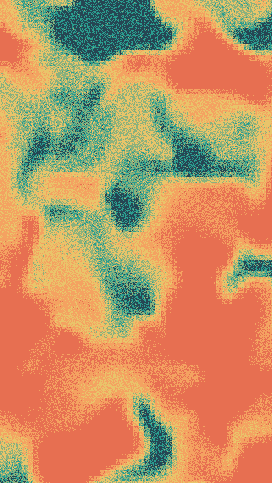

A warped noise field cut into flat bands, one band per ink, like a contour map with no lines. Grain shakes each pixel across band edges, and a block size can coarsen the map into square cells.

terrain renders a Loop: 30 frames at 12 fps, in which the bands swell, split and merge in place, then return to where they began. Nothing slides, and the grain holds still. The land has already changed shape at frame 0, so frame 0 differs from the Still. Its site page is [playgrnd.tools/terrain](https://www.playgrnd.tools/terrain/).

## Still



Seed 7, rendered by:

```sh
tirage derive --seed 7 --tool terrain | tirage render --size 540x960 -o terrain.png
```

## Parameters

From [`tirage tools`](/cli-reference/tools/), without the 11 shared [dither and grain](/concepts/dither-and-grain/) Parameters:

```
terrain  30 frames
  scale       0.6..=9   step 0.1
  warp        0..=3     step 0.02
  oct         1..=7     step 1
  contrast    0.5..=4   step 0.05
  balance     -1.2..=1.2 step 0.05
  grain       0..=1.2   step 0.01
  block       0..=14    step 1
```

A Seed draws `scale`, `warp`, `oct`, `contrast`, `balance` and `block`. Each range comes from its [Taste bounds](/concepts/taste-bounds/), which sit within the range listed. `grain`, the Tool's own per-pixel noise, stays at 0.3.

The Palette takes any number of inks from 2, one band each, read in order.
