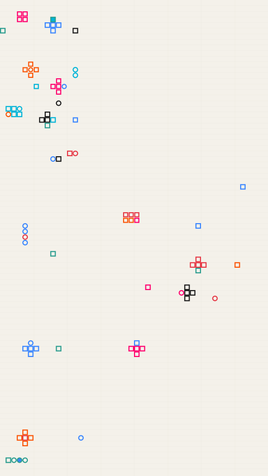

A board game left mid-play. Round and square counters sit on a faint ruled grid in runs, blocks, plus signs and singles. Each counter is a disc or square of one ink ringed by another, and some are hollow.

tokens renders a Loop: 36 frames at 14 fps, in which about half the clusters roll each counter's fill and ring through the Palette once, each counter a little ahead of the one before, while every position, size and shape holds. The roll is already under way at frame 0, so frame 0 differs from the Still. Its site page is [playgrnd.tools/tokens](https://www.playgrnd.tools/tokens/).

## Still



Seed 1, rendered by:

```sh
tirage derive --seed 1 --tool tokens | tirage render --size 540x960 -o tokens.png
```

SVG: yes. `-o tokens.svg` writes this Still as an [SVG](/cli-reference/render/#svg).

## Loop

<video src="/tools/tokens.mp4" width="360" height="640" autoplay loop muted playsinline></video>

The same Seed 1, encoded at 360x640 by:

```sh
tirage derive --seed 1 --tool tokens | tirage encode --size 360x640 -o tokens.mp4
```

## Parameters

From [`tirage tools`](/cli-reference/tools/), without the 11 shared [dither and grain](/concepts/dither-and-grain/) Parameters:

```
tokens  36 frames, svg
  cols        4..=120   step 1
  ruleEvery   1..=10    step 1
  grid        0..=1     step 0.01
  count       1..=400   step 1
  wRun        0..=100   step 1
  wBlock      0..=100   step 1
  wPlus       0..=100   step 1
  wOne        0..=100   step 1
  clump       0..=1     step 0.01
  align       0..=1     step 0.01
  runLen      2..=12    step 1
  upright     0..=1     step 0.01
  sizeT       0.03..=1  step 0.01
  svar        0..=1     step 0.01
  hier        0..=1     step 0.01
  square      0..=1     step 0.01
  strokeW     0..=8     step 0.5
  hollow      0..=1     step 0.01
  kin         0..=1     step 0.01
  break       0..=1     step 0.01
```

A Seed draws every Parameter listed. It keeps `cols` to 4..48, `count` to 8..400, `sizeT` to 0.2..1 and `strokeW` to 0.5..8, because a wide board or tiny counters leave only specks, and a hollow counter with no outline disappears into the board. Every other Parameter is drawn across its full range.

`cols` sets the board columns, and `ruleEvery` and `grid` set how often a vertical rule falls and how strongly the grid shows. `count` is how many clusters to place. `wRun`, `wBlock`, `wPlus` and `wOne` weight the four cluster shapes, and `runLen` and `upright` set how long a run gets and how often it stands up. `clump` gathers clusters together and `align` lines them up on a few rows and columns. `sizeT`, `svar` and `hier` set the counter size, how much it varies, and how often a cluster comes out large. `square` is the share of square counters, `strokeW` the outline width and `hollow` the share of hollow counters. `kin` sets how far in hue an outline ink can be from its fill, and `break` is the chance a counter takes its own inks.

The Palette takes any number of inks from 2, read by position. Fills and outlines both come from it. The board `#F4F1EA` and the rule ink `#D9D4C7` are fixed by the Tool.
