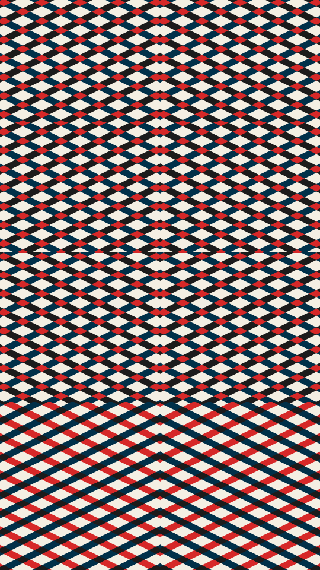

Horizontal bands stack down the frame, and each one fills with straight stripes at an angle. A band lays them out one of four ways: one diagonal field, a chevron of two mirrored halves, four mirrored quarters, or two layers of stripes that cross. Where crossing stripes overlap, a third ink shows.

vee renders a Loop: 72 frames at 12 fps, in which every band's stripes slide two repeats across themselves, crossing layers against each other, while the bands, angles and inks hold. Frame 0 is the Still. Its site page is [playgrnd.tools/vee](https://www.playgrnd.tools/vee/).

## Still



Seed 1, rendered by:

```sh
tirage derive --seed 1 --tool vee | tirage render --size 540x960 -o vee.png
```

SVG: yes. `-o vee.svg` writes this Still as an [SVG](/cli-reference/render/#svg).

## Parameters

From [`tirage tools`](/cli-reference/tools/), without the 11 shared [dither and grain](/concepts/dither-and-grain/) Parameters:

```
vee  72 frames, svg
  styles      Auto, Chevron, Quad, Diagonal, Cross
  angle       15..=75   step 1
  width       0.4..=2.2 step 0.05
  weight      0.15..=0.85 step 0.01
  bands       1..=4     step 1
```

A Seed draws every Parameter listed, each across its full range. `styles` picks the layout for every band. Auto lets the Tool seed pick one per band instead. `angle` is the stripe angle in degrees, `width` scales the stripe spacing, and `weight` sets how much of each step is stripe. `bands` sets how many bands stack down the frame.

The Palette has 4 inks by role: Base, Ink 1, Ink 2 and Cross. vee takes at most 4. Base is the ground. The stripe inks cycle Ink 1, Ink 2, Cross. Each band starts on Ink 1 or Ink 2, and a crossing band takes the next two in the cycle for its second layer and for the overlap.
