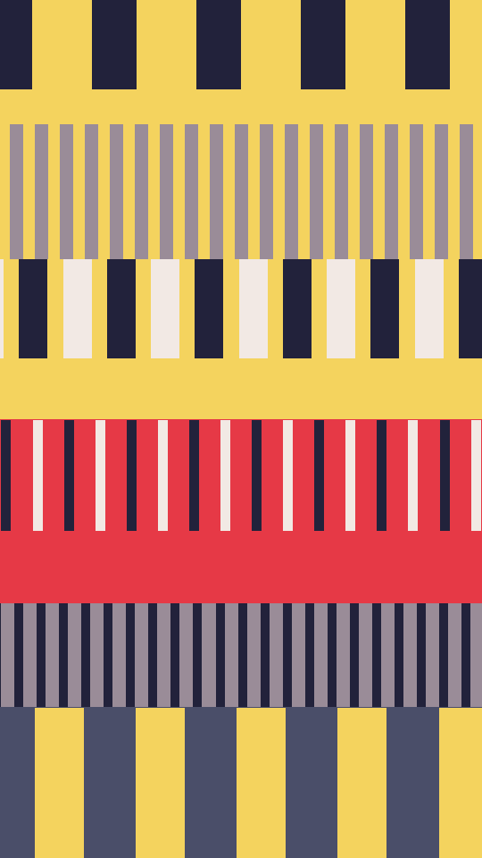

Bands of woven cloth stacked down the frame. Each band has a ground ink and vertical stripes in one or two thread inks, at its own pitch, width and height. Some bands are fine pinstripes and some are broad bars.

weave renders a Loop: 120 frames at 24 fps, in which each band's stripes slide left or right by one or two whole repeats, while the bands and their inks hold. Frame 0 is the Still. Its site page is [playgrnd.tools/weave](https://www.playgrnd.tools/weave/).

## Still



Seed 1, rendered by:

```sh
tirage derive --seed 1 --tool weave | tirage render --size 540x960 -o weave.png
```

SVG: yes. `-o weave.svg` writes this Still as an [SVG](/cli-reference/render/#svg).

## Loop

<video src="/tools/weave.mp4" width="360" height="640" autoplay loop muted playsinline></video>

The same Seed 1, encoded at 360x640 by:

```sh
tirage derive --seed 1 --tool weave | tirage encode --size 360x640 -o weave.mp4
```

## Parameters

From [`tirage tools`](/cli-reference/tools/), without the 11 shared [dither and grain](/concepts/dither-and-grain/) Parameters:

```
weave  120 frames, svg
  bands       3..=12    step 1
  stripe      0.5..=2.2 step 0.05
```

A Seed draws `bands` and `stripe`, each across its full range. `stripe` scales the pitch of every band.

The Palette takes any number of inks from 2. The Tool seed picks each band's ground and threads from it, never giving a thread the ground's ink.
