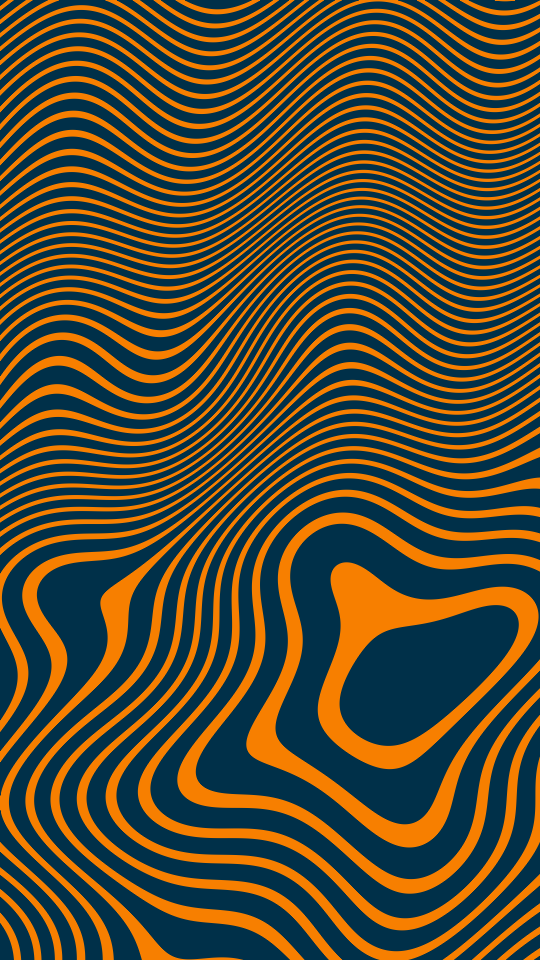

Op-art stripes. A handful of centres each add their distance to one field, some counted positive and some negative. The bands of equal total are rings round the centres, curves between them, and pinched eyes where two families meet. A warp bends the field before the bands are read off it.

whorl renders a Loop: 36 frames at 12 fps, in which every stripe streams outward through the field to where the next one began, while the centres and the warp hold. Frame 0 is the Still. Its site page is [playgrnd.tools/whorl](https://www.playgrnd.tools/whorl/).

## Still



Seed 9, rendered by:

```sh
tirage derive --seed 9 --tool whorl | tirage render --size 540x960 -o whorl.png
```

## Loop

<video src="/tools/whorl.mp4" width="360" height="640" autoplay loop muted playsinline></video>

The same Seed 9, encoded at 360x640 by:

```sh
tirage derive --seed 9 --tool whorl | tirage encode --size 360x640 -o whorl.mp4
```

## Parameters

From [`tirage tools`](/cli-reference/tools/), without the 11 shared [dither and grain](/concepts/dither-and-grain/) Parameters:

```
whorl  36 frames
  centres     1..=14    step 1
  pull        0..=1     step 0.01
  push        0..=1     step 0.01
  stripes     2..=90    step 1
  weight      0..=1     step 0.01
  dirs        Smooth, Turbulent, Ripple [no Taste]
  warp        0..=1     step 0.01
  detail      0..=1     step 0.01
```

A Seed draws every Parameter listed. Each range comes from its [Taste bounds](/concepts/taste-bounds/), which sit within the range listed: `stripes` stays within 2..=30 and `weight` within 0.2..=0.8. The first ink is the ground, and every later ink is a stripe colour, taken in turn.
